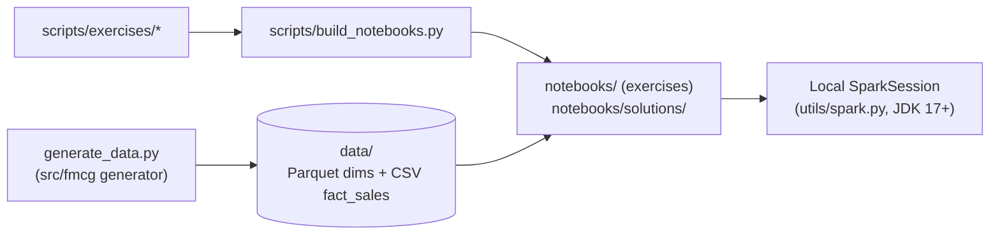

# pyspark-fmcg-training-kit

A hands-on PySpark training kit for mid-level data engineers, built on synthetic dirty data from a fictional FMCG retailer.

- **Exercises** with `# TODO` cells and **CHECK** assertions that print ✅ when correct
- **Fully worked solutions** for every exercise
- A **configurable synthetic dirty-data generator** for a fictional FMCG
  (fast-moving consumer goods) retailer

Topics: DataFrame fundamentals, joins & window functions, data cleaning,
performance/advanced Spark.

## Status

Training material. Last substantive change: 2026-06-14.

## Architecture



### Project layout

```
src/fmcg/            Data generator (catalog, generator, dirty-data injection)
utils/spark.py       SparkSession builder + dataset loaders (handles JAVA_HOME)
scripts/
  bootstrap_java.py  Downloads portable Temurin JDK 17 into .jdk/
  build_notebooks.py Renders notebooks from scripts/exercises/*
  exercises/         Exercise definitions (one module per notebook)
generate_data.py     CLI entry point for data generation
notebooks/           Exercise notebooks (+ solutions/)
data/                Generated datasets (git-ignored)
```

### The data

A small FMCG star schema, generated reproducibly (default seed `42`).

| Dataset | Format | Notes |
|---------|--------|-------|
| `dim_products` | Parquet | product, category, subcategory, brand, unit_cost, supplier |
| `dim_stores` | Parquet | region, city, channel, size, open_date |
| `dim_customers` | Parquet | loyalty tier, signup date, region |
| `dim_suppliers` | Parquet | country, lead time |
| `dim_promotions` | Parquet | promo type, discount %, date window |
| `fact_inventory` | Parquet | per-store/product stock snapshots |
| `fact_sales` | **CSV** | the large, deliberately-dirty transaction log |

#### Deliberately injected data problems

The raw `fact_sales` CSV and some dimension text are messy on purpose, so the
data-quality exercises have real targets:

- Null `customer_id` (anonymous sales) and `promo_id` (no promotion)
- Duplicate transactions
- Non-numeric (`"N/A"`) and negative quantities
- Out-of-range discounts (outside `[0, 1]`)
- Orphan foreign keys (sales referencing non-existent products)
- Inconsistent casing/whitespace in `category` and `region`
- One **skewed mega-store** (`ST001`) holding ~18% of all sales

> Spark 4 runs in **ANSI mode**, so a plain `.cast("int")` on `"N/A"` *throws*.
> The exercises use `try_cast` to handle this — a realistic modern-Spark skill.

## Quick start

```bash
# 1. Install Python deps (uv reads pyproject.toml / uv.lock)
uv sync

# 2. One-time: download a portable JDK 17 (PySpark needs Java; no sudo required)
uv run python scripts/bootstrap_java.py

# 3. Generate the datasets into ./data
uv run python generate_data.py

# 4. Launch Jupyter and open notebooks/00_environment_check.ipynb first
uv run jupyter lab
```

> **Java:** PySpark 4.1 needs Java 17+. `bootstrap_java.py` installs Temurin
> into `.jdk/` (git-ignored). If you already have JDK 17+, set `JAVA_HOME` and skip step 2.

### The exercises

Each task has a markdown prompt, a `# TODO` cell, and a **CHECK** cell.
Solutions live in `notebooks/solutions/`.

| Notebook | Focus |
|----------|-------|
| `00_environment_check` | Confirm Spark + data are working (no tasks) |
| `01_core_dataframe_ops` | Safe casting, derived columns, filtering, groupBy/agg, monthly trend |
| `02_joins_and_windows` | Multi-table joins, broadcast joins, ranking, rolling sums, lag/WoW, RFM |
| `03_data_quality` | Auditing, dedup, safe casts, text normalization, orphan FKs, clean assembly |
| `04_performance_advanced` | Partitioning & pruning, broadcast tuning, skew, caching, UDF vs native, Spark SQL |

### For the interviewer / trainer

- **As an assessment:** hand over the repo without `notebooks/solutions/`. A
  candidate passes a task when its CHECK cell prints ✅. Running every notebook
  top-to-bottom with all greens is the objective bar.
- **As self-study:** keep the solutions; learners compare approaches.
- All solution notebooks are verified to run end-to-end against freshly
  generated data.

## Configuration

No `.env` file is used.

| Variable | Purpose |
|----------|---------|
| `JAVA_HOME` | Optional: an existing JDK 17+; otherwise `utils/spark.py` uses the JDK that `bootstrap_java.py` installs into `.jdk/` |

Generator options:

```bash
uv run python generate_data.py --scale 2.0    # ~1M sales rows (perf exercises)
uv run python generate_data.py --scale 0.1    # tiny & fast
uv run python generate_data.py --clean        # no injected data issues
uv run python generate_data.py --seed 7       # different reproducible dataset
uv run python generate_data.py --out data2    # custom output directory
```

## Testing

There is no automated test suite or CI workflow. The solution notebooks are the end-to-end check: generate fresh data, then execute every solution notebook; each CHECK cell must print ✅.

```bash
uv sync
uv run python scripts/bootstrap_java.py      # skip if JAVA_HOME points to JDK 17+
uv run python generate_data.py
uv run jupyter nbconvert --to notebook --execute --output-dir /tmp/fmcg-solutions notebooks/solutions/*.ipynb
```

### Regenerating the notebooks

The notebooks are generated from `scripts/exercises/` so prompts, solutions, and
checks stay in sync. After editing an exercise module:

```bash
uv run python scripts/build_notebooks.py
```

## Deployment

Not deployed; local only.

## Known gaps

- No automated test suite and no CI workflow; the solution notebooks are run by hand.
- The exercise notebooks have drifted from `scripts/exercises/`: 5 CHECK cells in `notebooks/01_core_dataframe_ops.ipynb` and 6 in `notebooks/02_joins_and_windows.ipynb` were strengthened in the notebooks only. `scripts/build_notebooks.py` would replace them with the weaker checks, and the matching solution notebooks still carry the weaker checks.
- `generate_data.py` fails on JDK 25 (`UnsupportedOperationException: getSubject is not supported`); only JDK 17 from `scripts/bootstrap_java.py` is verified.
- No linter or formatter is configured.
- `pyproject.toml` still has the placeholder description "Add your description here".

## License

No license granted yet.
